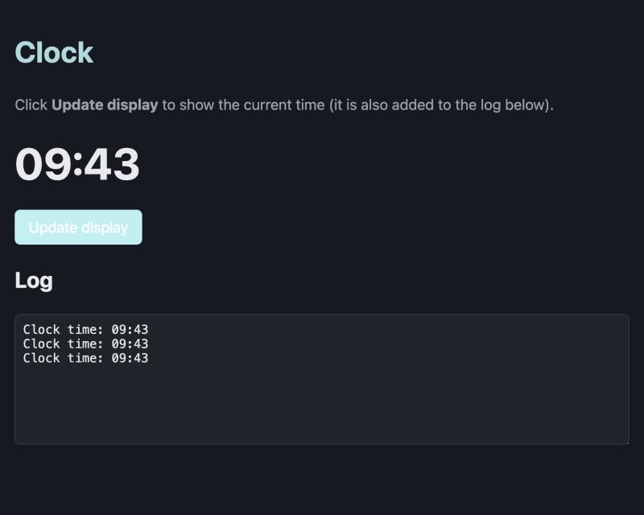

# Exercise 2 - an interactive clock

Start from your [exercise 1](README_ex1_simple.md) clock, and make it interactive:

- an **Update display** button: each click reads the current time again, and shows it
- a read-only **Log** box at the bottom of the page: each click also adds a line to it, e.g. `Clock time: 09:43`

(The log is on the page, rather than `console.log()`, so you can see it even where the browser's console is
hidden.)

The solution is in the `mvc_clock2/` project, next to this one - so if you get stuck, look there.



---

## Step 1 - add a button and a log to the HTML

In `public/index.html`, add an instruction under the `<h1>`:

```html
      <p class="muted">Click <b>Update display</b> to show the current time (it is also added to the log below).</p>
```

and add this under the `<p id="time">`:

```html
      <button id="update-button">Update display</button>

      <!-- Clock.ts writes its log messages here (instead of to the console) -->
      <h2>Log</h2>
      <textarea id="log" rows="8" readonly></textarea>
```

`readonly` stops the user typing into the log - only our code can change it.

Style the log, at the end of `public/css/styles.css`:

```css
#log {
  width: 100%;
  font-family: ui-monospace, Menlo, Consolas, monospace;
  background: var(--card);
  color: var(--text);
  border: 1px solid var(--line);
  border-radius: 6px;
  padding: 8px;
  resize: vertical;
}
```

Save and refresh: the button and the empty log appear, but clicking does nothing yet.

---

## Step 2 - move "read the time" out of the constructor

In exercise 1 the constructor read the time, so it could only happen **once**. Move it into a method of its own,
so we can call it again on every click.

In `src/Clock.ts`, give the properties starting values (the constructor no longer sets them):

```ts
  private hours = 0;
  private minutes = 0;
```

remove the three lines that read the time from the constructor, and add this method:

```ts
  // Reads the current time from the computer's clock
  updateTime(): void {
    const now = new Date();
    this.hours = now.getHours();
    this.minutes = now.getMinutes();
  }
```

---

## Step 3 - the clock writes to the log

The `Clock` now needs the log `<textarea>` too. Add a property for it, and a second constructor parameter:

```ts
  private displayElement: HTMLElement;
  private logElement: HTMLTextAreaElement;

  constructor(displayElement: HTMLElement, logElement: HTMLTextAreaElement) {
    this.displayElement = displayElement;
    this.logElement = logElement;
  }
```

A textarea's text is its `value`. `+=` adds the new line to the end of what is already there, and `\n` is a new
line. Setting `scrollTop` to `scrollHeight` scrolls to the bottom, so the newest line is always visible:

```ts
  // Adds the time as a new line in the log textarea, and scrolls down so the newest line is visible
  log(): void {
    this.logElement.value += `Clock time: ${this.getTimeString()}\n`;
    this.logElement.scrollTop = this.logElement.scrollHeight;
  }
```

Update the comment at the top of the file, too - the `Clock` now does **everything**:

```ts
// Clock.ts - a simple clock that does EVERYTHING itself:
//   - it holds the time (the data)
//   - it shows the time on the HTML page, and adds it to the log on the page (the output)
// Later we will split these jobs apart with the MVC design pattern.
```

---

## Step 4 - `main.ts` reacts to the button

Replace `src/main.ts` with:

```ts
// main.ts wires everything together: it finds the HTML elements, creates the clock,
// and updates the clock each time the user clicks the "Update display" button.

import { Clock } from "./Clock.ts";

const timeElement = document.getElementById("time") as HTMLElement;
const updateButton = document.getElementById("update-button") as HTMLButtonElement;
const logElement = document.getElementById("log") as HTMLTextAreaElement;

const clock = new Clock(timeElement, logElement);

updateButton.addEventListener("click", () => {
  clock.updateTime(); // (1) read the current time
  clock.display();    // (2) show it on the page
  clock.log();        // (3) add it to the log on the page
});
```

`addEventListener("click", ...)` takes a function - here an **arrow function**, `() => { ... }` - and calls it
every time the button is clicked.

---

## Check

- [ ] The page starts with `--:--`, and an empty log
- [ ] Clicking **Update display** shows the current time, and adds a `Clock time: ...` line to the log
- [ ] Wait a minute and click again: the time changes, and a new line is added
- [ ] You can't type into the log
- [ ] The console shows `0 type errors, 0 lint warnings`

## Try it yourself

1. Add a **Clear log** button, that empties the log (`value = ""`).
2. Put the date and time of each click in the log: `new Date().toLocaleString()`.
3. Look at `Clock`: it holds **data** (the time), and does **output** (the page, the log). What would you have to
   change if you wanted to log to `console.log()` as well? Or show the time in a second place on the page?

Next: [exercise 3 - bumper buttons](README_ex3_bumpers.md).
