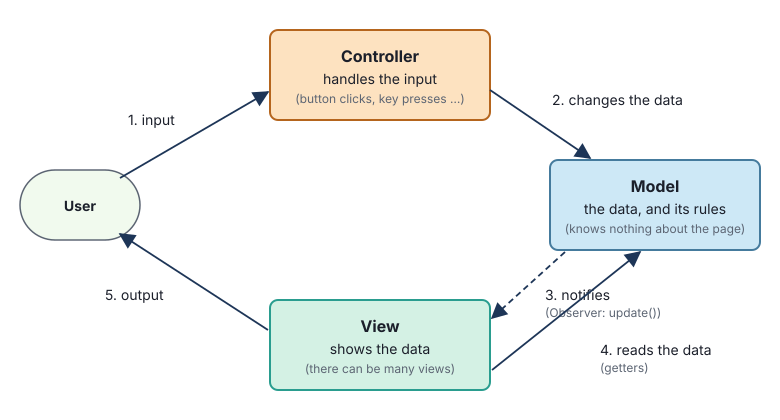
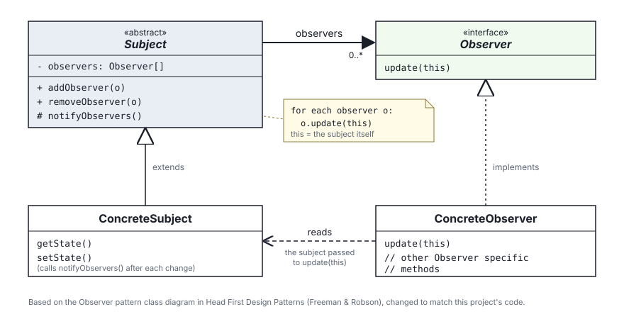
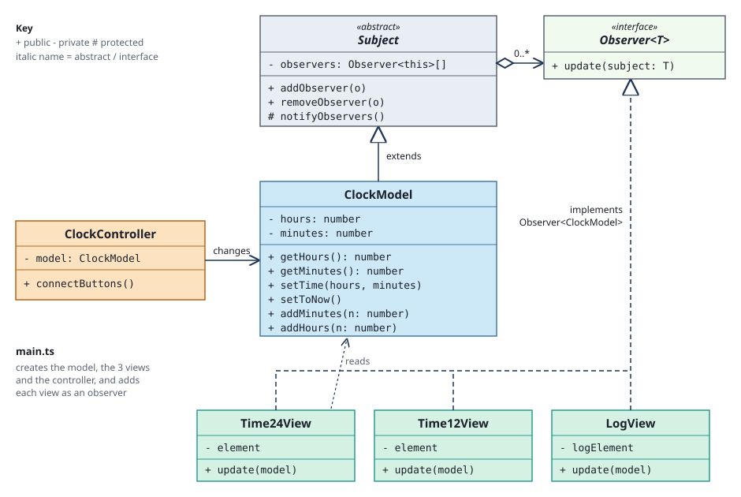

# Exercise 5 - MVC: Model, View, Controller

Start from your [exercise 4](README_ex4_24_and_12_hour.md) clock: bumper buttons, a 24 hour and a 12 hour display,
and a log.

It **works**, but [exercise 4](README_ex4_24_and_12_hour.md) showed its problem: the `Clock` class does every
job. It is the data, the rules for changing the data, and every display. Adding a display means changing
`Clock`, and you can't test `Clock` without a web page.

In this exercise you will rebuild the **same** clock - it will look and behave exactly the same - using the
**Model-View-Controller (MVC)** design pattern.

---

## Part 1 - the MVC design pattern

MVC splits a program that has a user interface into three kinds of object, each with **one** job:

| Part | Its job | Knows about |
|------|---------|-------------|
| **Model** | holds the **data**, and the **rules** for changing it | nothing else - no HTML, no buttons, no views |
| **View** | **shows** the data to the user (output) | the model, so it can read the data |
| **Controller** | turns the user's **input** (clicks, key presses ...) into changes to the model | the model, so it can change it |



Follow the numbers round the diagram:

1. **input** - the user clicks a button
2. the **controller** handles the click, by **changing the model** (calling one of its methods)
3. the **model** changes its data, then **notifies** every view that it has changed
4. each **view** **reads** the data it needs from the model (with getters) ...
5. ... and **shows** it to the user

### The model doesn't know about the views - the Observer pattern

How can the model notify the views, if it knows nothing about them? With the **Observer** design pattern,
which you have met before. It has two roles:

- a **Subject** keeps a list of **observers**. It has methods to add and remove observers, and after every
  change it notifies them all
- every **Observer** implements an interface with one method, `update()`. The subject calls it on each
  observer in its list



This is based on the Observer pattern class diagram in *Head First Design Patterns*, with three changes to
match the code in this exercise:

1. **`Subject` is an abstract class, not an interface.** Adding, removing and notifying observers is the same
   code for every subject, so it is written **once**, in `Subject`, and every concrete subject **inherits** it
   (the **solid** line with the hollow triangle: `extends`). In Head First, `Subject` is an interface, so every
   concrete subject has to write those three methods itself.
2. **`update(this)` instead of `update()`.** When the subject notifies its observers, it passes **itself**:
   `observer.update(this)`. So the observer can read the subject's state straight away.
3. **The observer doesn't keep a reference to its subject.** In Head First, each concrete observer stores
   its `subject` (a solid arrow), so it can read its state later. Because `update(this)` passes the subject
   in, the observer doesn't need to store it - it only **reads** it during `update()` (the dashed arrow).

`notifyObservers()` has a `#`: in UML, `#` means **protected** - a subclass can call it, but no other class
can. (`+` is public, `-` is private.) Head First also calls `addObserver()` `registerObserver()` - the same
thing.

In MVC, the **model** is the concrete subject, and the **views** are the concrete observers. The model only
knows that its observers have an `update()` method. They might show the time as text, draw a clock face, write
to a log, or be part of an automatic test - the model doesn't know, and doesn't need to.

### Why bother?

- **One job each**: each class is small, and easy to understand
- **Many views**: adding a view means writing a new class and adding it as an observer - the model doesn't
  change at all
- **Always up to date**: the controller never has to remember to update the display - the model tells every
  view about every change, automatically
- **Testable**: the model has no HTML in it, so it can be tested with automatic tests

### Who creates them?

Something has to create the model, the views and the controller, and connect them together. Here, that is
`main.ts` - and that is all it does.

---

## Part 2 - designing the MVC clock

Sort the old `Clock` class's jobs into model, views and controller:

| In exercise 4 | In the MVC clock |
|---------------|------------------|
| `hours`, `minutes` | **model**: `ClockModel` |
| `updateTime()`, `addMinutes()`, `addHours()` | **model**: `setToNow()`, `addMinutes()`, `addHours()` (+ a new `setTime()`) |
| `getTime24String()`, `getTime12String()` | plain functions, `format24()` and `format12()`, in `timeFormat.ts`, used by the views |
| `display()` (24 hour part) | **view**: `Time24View` |
| `display()` (12 hour part) | **view**: `Time12View` |
| `log()` | **view**: `LogView` (a log is just another way of showing the data) |
| the button event listeners in `main.ts` | **controller**: `ClockController` |
| calling `display()` and `log()` after every change | nobody! The model notifies its observers |
| (nothing) | `Subject` - an abstract superclass, that `ClockModel` inherits observer handling from |
| (nothing) | `Observer<T>` - the interface the views implement |

Here is the design as a UML class diagram:



It is the Observer pattern diagram again, with real names: `ClockModel` is the concrete subject, and the
three views are the concrete observers.

- the **controller** has a reference to the model, so it can **change** it
- `ClockModel` **extends** `Subject` (the solid line with the hollow triangle), so it **inherits**
  `addObserver()`, `removeObserver()` and `notifyObservers()` - you won't see them in `ClockModel.ts`
- `Subject` has a list of observers (the diamond and `0..*`: zero or more observers)
- the three **views** **implement** `Observer<ClockModel>` (the dashed line with the hollow triangle)
- the views **read** the model, through the `model` passed to `update(model)`

Notice what `ClockModel` does *not* include: nothing about HTML, text formats, buttons or logs - and nothing
about observers either, because that is all inherited.

---

## Part 3 - building it

You'll replace `src/Clock.ts` with 8 smaller files. The views go in a folder of their own, `src/views/`, so
it is easy to see which files are views. The HTML and CSS don't change, except for the two HTML
comments that mention `Clock.ts`: change them to say `Time24View and Time12View write the time into these two
elements` and `LogView writes its log messages here`.

Delete `src/Clock.ts` when you are ready - `main.ts` will be rewritten in step 7.

### Step 1 - the Observer pattern: `Observer` and `Subject`

These two files are the Observer pattern itself. There is nothing about clocks in them, so they could be used
in any project.

Create `src/Observer.ts`:

```ts
// Observer.ts - anything that wants to be told when a Subject changes (in MVC: the views).
// T is the type of subject being observed, so that update() gets the real type - e.g. Observer<ClockModel>.

export interface Observer<T> {
  update(subject: T): void;
}
```

An `interface` lists the methods a class must have, without any code.

`<T>` makes it a **generic** interface: `T` stands for a type, chosen by whoever uses it. A view that observes
a `ClockModel` implements `Observer<ClockModel>`, so its `update()` is given a `ClockModel` - and TypeScript
knows it can call `getHours()` on it.

Then create `src/Subject.ts`:

```ts
// Subject.ts - the Subject of the Observer pattern: something that keeps a list of observers, and tells them
// all when it changes. It is abstract - it is only used as a superclass, e.g. `class ClockModel extends Subject`.
//
// `this` (as a type) means "whichever subclass this is": in ClockModel, Observer<this> is Observer<ClockModel>.

import type { Observer } from "./Observer.ts";

export abstract class Subject {
  private observers: Observer<this>[] = [];

  addObserver(observer: Observer<this>): void {
    this.observers.push(observer);
  }

  removeObserver(observer: Observer<this>): void {
    this.observers = this.observers.filter((o) => o !== observer);
  }

  // protected: subclasses can call it (after they change), but other classes can't
  protected notifyObservers(): void {
    for (const observer of this.observers) {
      observer.update(this); // pass ourself, so each observer can read our data
    }
  }
}
```

- `abstract class` - a class that can't be created with `new Subject()`. It is only there to be a superclass.
- `Observer<this>[]` - in a type, `this` means "the class this object really is". In a `ClockModel`, it means
  `Observer<ClockModel>[]`. So `Subject` never needs to know about clocks.
- `filter()` makes a new array, keeping only the items for which the function returns `true` - here, every
  observer except the one being removed.
- `notifyObservers()` is `protected`: `ClockModel` can call it, but the controller (or anything else) can't.
  Only the model should decide when its observers are told about a change.

### Step 2 - the model

Create `src/ClockModel.ts`. Most of it is the old `Clock`'s code - but look at what is new:

- `extends Subject`: the model **inherits** the list of observers, `addObserver()`, `removeObserver()` and
  `notifyObservers()`
- `setTime()`: **every** change to the time goes through it, and it ends by calling `this.notifyObservers()`
- there is nothing about HTML - no elements, no `textContent`

```ts
// ClockModel.ts - the MODEL: the clock's data (the time), and the rules for changing it.
// It knows nothing about HTML, buttons or the log. When it changes, it tells its observers (the views):
// adding observers and notifying them is inherited from Subject.

import { Subject } from "./Subject.ts";

const MINUTES_PER_DAY = 24 * 60;

export class ClockModel extends Subject {
  private hours = 0;
  private minutes = 0;

  // --- reading the time ---

  getHours(): number {
    return this.hours;
  }

  getMinutes(): number {
    return this.minutes;
  }

  // --- changing the time: every change ends by notifying the observers ---

  setTime(hours: number, minutes: number): void {
    this.hours = hours;
    this.minutes = minutes;
    this.notifyObservers();
  }

  // Sets the clock to the current time, from the computer's clock
  setToNow(): void {
    const now = new Date();
    this.setTime(now.getHours(), now.getMinutes());
  }

  // Moves the time forward (or back, if minutesToAdd is negative), wrapping round midnight
  addMinutes(minutesToAdd: number): void {
    const totalMinutes = this.hours * 60 + this.minutes + minutesToAdd;
    // % can give a negative answer in TypeScript (-1 % 1440 is -1), so add MINUTES_PER_DAY and % again
    const wrapped = ((totalMinutes % MINUTES_PER_DAY) + MINUTES_PER_DAY) % MINUTES_PER_DAY;
    this.setTime(Math.floor(wrapped / 60), wrapped % 60);
  }

  addHours(hoursToAdd: number): void {
    this.addMinutes(hoursToAdd * 60);
  }
}
```

`ClockModel` never mentions observers, except to call `this.notifyObservers()` - which it can, because it is
`protected` in its superclass.

### Step 3 - the time formats

Formatting the time as text is a job for the views, not the model - but two views (and later, more) need the
same formats. So put them in plain functions, in `src/timeFormat.ts`:

```ts
// timeFormat.ts - turns hours and minutes into text. Used by the views.
// These are plain functions (no HTML), so they are easy to test.

// 24 hour form, e.g. "09:05" or "21:05"
export function format24(hours: number, minutes: number): string {
  const hh = String(hours).padStart(2, "0");
  const mm = String(minutes).padStart(2, "0");
  return `${hh}:${mm}`;
}

// 12 hour form, e.g. "9:05 am" or "9:05 pm"
export function format12(hours: number, minutes: number): string {
  const amPm = hours < 12 ? "am" : "pm";
  const hours12 = hours % 12 === 0 ? 12 : hours % 12; // 0 -> 12 (midnight), 13 -> 1, ...
  const mm = String(minutes).padStart(2, "0");
  return `${hours12}:${mm} ${amPm}`;
}
```

### Step 4 - the two time views

Each view is given the element it draws in, and implements `Observer<ClockModel>`. When the model calls `update()`,
the view reads the time, and shows it. That is all it does.

Create a folder, `src/views/`, and in it `src/views/Time24View.ts`:

```ts
// Time24View.ts - a VIEW: shows the model's time in 24 hour form.

import type { ClockModel } from "../ClockModel.ts";
import type { Observer } from "../Observer.ts";
import { format24 } from "../timeFormat.ts";

export class Time24View implements Observer<ClockModel> {
  private element: HTMLElement;

  constructor(element: HTMLElement) {
    this.element = element;
  }

  update(model: ClockModel): void {
    this.element.textContent = format24(model.getHours(), model.getMinutes());
  }
}
```

The imports start with `../`, which means "go up one folder": `ClockModel.ts`, `Observer.ts` and
`timeFormat.ts` are in `src/`, one folder above `src/views/`.

`implements Observer<ClockModel>` makes TypeScript check that the class really has an `update()` method, that
takes a `ClockModel`.

Now write `src/views/Time12View.ts` yourself: it is the same, but named `Time12View`, and it uses `format12`.

### Step 5 - the log view

The log is just another view of the model, so it goes in `src/views/` too. `src/views/LogView.ts`:

```ts
// LogView.ts - a VIEW: adds a line to the log textarea every time the model changes.

import type { ClockModel } from "../ClockModel.ts";
import type { Observer } from "../Observer.ts";
import { format24 } from "../timeFormat.ts";

export class LogView implements Observer<ClockModel> {
  private logElement: HTMLTextAreaElement;

  constructor(logElement: HTMLTextAreaElement) {
    this.logElement = logElement;
  }

  update(model: ClockModel): void {
    this.logElement.value += `Clock time: ${format24(model.getHours(), model.getMinutes())}\n`;
    this.logElement.scrollTop = this.logElement.scrollHeight; // keep the newest line visible
  }
}
```

### Step 6 - the controller

The controller connects each button to a change to the model. Compare it with exercise 3's `main.ts`: there is
no `showTime()` any more - the controller only changes the model, and the model notifies the views.

`src/ClockController.ts`:

```ts
// ClockController.ts - the CONTROLLER: turns the user's input (button clicks) into changes to the model.
// It never touches the displays or the log - the model tells the views about every change.

import type { ClockModel } from "./ClockModel.ts";

export class ClockController {
  private model: ClockModel;

  constructor(model: ClockModel) {
    this.model = model;
  }

  // Connects each button on the page to a change to the model
  connectButtons(): void {
    this.onClick("hour-up", () => this.model.addHours(1));
    this.onClick("hour-down", () => this.model.addHours(-1));
    this.onClick("minute-up", () => this.model.addMinutes(1));
    this.onClick("minute-down", () => this.model.addMinutes(-1));
    this.onClick("now-button", () => this.model.setToNow());
  }

  private onClick(buttonId: string, action: () => void): void {
    const button = document.getElementById(buttonId) as HTMLButtonElement;
    button.addEventListener("click", action);
  }
}
```

### Step 7 - `main.ts` connects them together

Replace `src/main.ts` with:

```ts
// main.ts creates the model, the views and the controller, and connects them together.

import { ClockController } from "./ClockController.ts";
import { ClockModel } from "./ClockModel.ts";
import { LogView } from "./views/LogView.ts";
import { Time12View } from "./views/Time12View.ts";
import { Time24View } from "./views/Time24View.ts";

// (1) the HTML elements that the views draw in
const time24Element = document.getElementById("time-24") as HTMLElement;
const time12Element = document.getElementById("time-12") as HTMLElement;
const logElement = document.getElementById("log") as HTMLTextAreaElement;

// (2) the model
const model = new ClockModel();

// (3) the views - create each one, and add it to the model as an observer
model.addObserver(new Time24View(time24Element));
model.addObserver(new Time12View(time12Element));
model.addObserver(new LogView(logElement));

// (4) the controller - turns button clicks into changes to the model
const controller = new ClockController(model);
controller.connectButtons();

// (5) start at the current time - this notifies the views, so they draw for the first time
model.setToNow();
```

Setting up the views takes two steps:

- **(1)** find each HTML element the views will draw in, and keep a reference to it in a variable
- **(3)** create each view - giving it its element - and add it to the model as an observer, in one line

The order matters: the views are added **before** `setToNow()`, so they are notified of the first time.

Save, and refresh the preview. The clock should look and behave **exactly** as it did in exercise 4.

---

## Part 4 - testing the model

The model and the time formats have no HTML in them, so now they **can** be tested automatically. Create
`tests/ClockModel_test.ts`:

```ts
import { assertEquals } from "@std/assert";
import { ClockModel } from "../src/ClockModel.ts";

Deno.test("addMinutes moves the time forward", () => {
  const model = new ClockModel();
  model.setTime(10, 15);
  model.addMinutes(5);
  assertEquals(model.getHours(), 10);
  assertEquals(model.getMinutes(), 20);
});

Deno.test("addMinutes wraps past midnight", () => {
  const model = new ClockModel();
  model.setTime(23, 59);
  model.addMinutes(1);
  assertEquals(model.getHours(), 0);
  assertEquals(model.getMinutes(), 0);
});

Deno.test("addHours wraps backwards past midnight", () => {
  const model = new ClockModel();
  model.setTime(0, 30);
  model.addHours(-1);
  assertEquals(model.getHours(), 23);
  assertEquals(model.getMinutes(), 30);
});

Deno.test("observers are told about every change", () => {
  const model = new ClockModel();
  let updates = 0;
  model.addObserver({ update: () => updates++ });

  model.setTime(10, 0);
  model.addMinutes(1);
  model.addHours(1);

  assertEquals(updates, 3);
});

Deno.test("a removed observer is not told about changes", () => {
  const model = new ClockModel();
  let updates = 0;
  const counter = { update: () => updates++ };
  model.addObserver(counter);

  model.setTime(10, 0); // told
  model.removeObserver(counter);
  model.setTime(11, 0); // not told

  assertEquals(updates, 1);
});
```

The last test uses a **fake observer**, `{ update: () => updates++ }`, that just counts how many times it is
notified - a test doesn't need a real view. The last test checks that `removeObserver()` (inherited from
`Subject`) works.

And `tests/timeFormat_test.ts`:

```ts
import { assertEquals } from "@std/assert";
import { format12, format24 } from "../src/timeFormat.ts";

Deno.test("format24 pads hours and minutes to 2 digits", () => {
  assertEquals(format24(9, 5), "09:05");
  assertEquals(format24(21, 45), "21:45");
});

Deno.test("format12 handles midnight, noon, morning and afternoon", () => {
  assertEquals(format12(0, 0), "12:00 am");
  assertEquals(format12(9, 5), "9:05 am");
  assertEquals(format12(12, 0), "12:00 pm");
  assertEquals(format12(13, 5), "1:05 pm");
  assertEquals(format12(23, 59), "11:59 pm");
});
```

Save: the console should now say `7 passed`. Open the test report (`test_output/index.html`) to see them all.

---

## Check

- [ ] The clock looks and behaves exactly as in exercise 4 (try the table of times from exercise 4 again)
- [ ] `ClockModel.ts` has no HTML in it - no `HTMLElement`, `document` or `textContent`
- [ ] `ClockModel.ts` has no observer code in it either - it is all inherited from `Subject`
- [ ] `ClockController.ts` never touches a display or the log
- [ ] The console shows `7 passed`, `0 type errors, 0 lint warnings`

## Try it yourself

1. **A new view**: add a `TitleView` that puts the time in the browser tab's title (`document.title`). How many
   existing files did you have to change? (Just `main.ts` - one line.)
2. **A console view**: add a `ConsoleView` that `console.log()`s every change. Again, the model doesn't change.
3. **A new controller**: let the user change the time with the keyboard - arrow up / down for the hours, left /
   right for the minutes (`document.addEventListener("keydown", ...)` and `event.key`). The views don't change.
4. **Inheritance or composition?** TypeScript lets a class extend only **one** superclass, and `ClockModel`
   has used it up on `Subject`. Another design: `ClockModel` *has* a `Subject` (a property) instead of *being*
   one, and passes `addObserver()` and `removeObserver()` on to it. What are the pros and cons of each?
5. **A real clock**: in `main.ts`, call `model.setToNow()` every second, with `setInterval()`. What happens to
   the log? Is that a problem in the model, a view or the controller - and how would you fix it?

Next: [exercise 6 - alarms](README_ex6_alarms.md).
